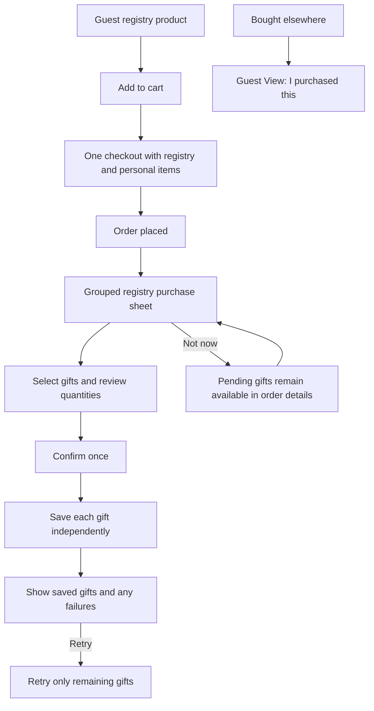

# Guest registry and purchase confirmation

Guest View uses the registry details layout: category avatar, owner, quantity
progress, greeting, All / Unpurchased / Purchased tabs, category/sort filters,
and flat product rows. Product images and names open product details. Owner
preview cannot record purchases or attach registry gift context.

After a successful checkout containing registry gifts, order confirmation opens
a bottom sheet. Gifts are grouped by registry, with their product, store and
quantity. Personal purchases are excluded. The guest selects gifts, reviews
quantities and confirms with their name/email entered once. No registry changes
until that explicit confirmation. Current checkout is COD: placement does not
imply payment or delivery.

The sheet checks authenticated order receipts, registry access and remaining
requested quantities when opened and again before saving. If quantities fall,
it asks for another confirmation instead of silently saving less. Access or
availability failures affect only their gifts. Pending gifts can be refreshed
and retried. Successful purchases refresh registry, overview, activity and
notification data.

The API validates that each order-linked gift belongs to the authenticated
customer's non-cancelled order. An order row lock serializes allocations and
limits the total registry allocations for a product to ordered units. Repeating
the same order/item save returns its existing purchase without another record,
notification or email. The authenticated order-receipts endpoint recovers
committed purchases after lost responses. Successful gifts are removed from
pending local attribution; Not now preserves unfinished gifts.

One order supports multiple stores, with a fulfilment per store and one delivery
address. Multiple destination addresses currently require separate orders.

Unmarked gift attribution remains per-user on this device for the latest 20
orders. It does not sync across devices. The server cart groups identical
products, and this client retains the latest registry selected for a product;
allocating the same cart product to multiple registries needs cart API support.
Purchases elsewhere still use the single-gift sheet from Guest View.

Validation includes grouped selection, partial failures, retries, lost responses,
quantity changes, access revocation, personal-item exclusion, owned-order receipt
access, and API idempotency. Native iPhone testing uses temporary registries,
products from two stores, a personal item, and a complete local COD checkout.

Simulator verification completed: selecting one/both gifts, deferring and
reopening from order details, saving two registry purchases from a three-item,
two-store order, and replaying a completed save without duplication. Temporary
registries, grants, purchase records, order, notifications and address were
removed afterward, and product inventory was restored.
